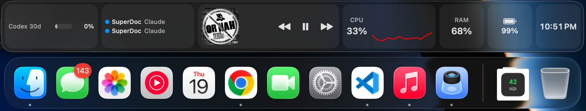

<div align="center">


# SuperDock

**A companion bar for your Mac's Dock. Live widgets, your AI limits and a coding-agents board, sitting right next to the Dock.**

Everything the paid dock apps charge for, free.

[](https://github.com/apurvamukherjee/SuperDoc/releases/latest)
[](#install)
[](LICENSE)


<br>



</div>

---

## Why SuperDock

|  |  |
|---|---|
| 🧠 **Your AI limits, always visible** | Claude Code's 5-hour and weekly usage and Codex's limits as rings or bars, with reset countdowns. |
| 🤖 **A live coding-agents board** | Every Claude Code and Codex session: working, needs your input, or done. Buddy pops up when an agent finishes or is waiting on you. |
| 🧲 **Sits on the real Dock** | It isn't a second dock floating somewhere else. The bar attaches to the left, right or top of the macOS Dock, follows it as it grows or shrinks, and hides along with it. |
| 💸 **Free. All of it.** | No Pro tier, no trial, no account. MIT licensed. |
| 🔒 **Local-first** | No analytics, no accounts. Prompts and code are never read, and clipboard history never leaves your Mac. |

## Features

### 🧩 57 widgets

| | |
|---|---|
| **AI** | AI Limits · Coding Agents |
| **Time** | Clock · Date · Analog Clock · World Clock · Month Calendar · Week Number · Day/Month/Year Progress · Unix Time · Moon Phase |
| **System** | CPU · Memory · Network · Disk · Battery · Thermal · Uptime |
| **Weather** | Weather · 7-Day Forecast · Sunrise & Sunset · Feels Like / Wind / UV / Rain |
| **Media & controls** | Now Playing (with cover art) · Quick Actions · Volume · Brightness · Wi-Fi |
| **Files & apps** | Folder / Smart Stack · File Shelf · Launchpad |
| **Focus** | Pomodoro · Timer · Stopwatch · Water Tracker · Quick Note · To-Do |
| **Developer** | Git Status · Local Ports · UUID · Password Generator |
| **Plugins** | Bitcoin · Ethereum · Crypto · Currency · Hacker News · Lobsters · DEV · GitHub Stars · npm · Public IP · xkcd · Quote · Random Fact · Cat Fact · ISS Tracker |
| **Fun** | Dice / Coin Flip · Magic 8 Ball |

Tiles come in compact, medium, wide and large sizes. Drag them to reorder on the bar, and right-click a tile for its options.

### 🪟 Windows & switching
- **Window previews** when you hover over Dock icons
- **⌥Tab switcher** that works across Spaces
- **⌃⌥1–9** opens the app in that Dock position
- **Alerts** when an app stops responding

### 📋 Clipboard & notch
- **History** on ⌥⌘V, filterable by text, links, colors, images and files
- **Pinned slots** on ⌃⌥⌘1–9: paste with one keystroke
- **Copy Peek** shows what you just copied
- **Notch shelf**: hover over the notch for your recent copies
- Anything a password manager marks as concealed is never read or stored

### 🎨 Make it yours
- **Profiles**, with a separate one for the laptop screen and each external display (⌃⌥⌘P cycles them)
- **Themes**: glass or solid, plus corner radius, opacity and accent color
- **Launchpad** (⌃⌥⌘L) with custom icons
- **Live wallpapers**: an animated aurora or your own video
- **Dock replacement mode**: hide the system Dock and let SuperDock take its place. Your Dock settings come back when you turn it off.

### 🔌 Plugins
A plugin is a single JSON file: an `https` URL, plus which values to show from the response. Plugins can't run code. Browse the [community gallery](gallery/) from **Settings → Plugins**, or [write your own](docs/plugins.md).

## Install

1. Download **SuperDock.dmg** from the [latest release](https://github.com/apurvamukherjee/SuperDoc/releases/latest).
2. Drag **SuperDock** into **Applications**.
3. Open it. The welcome window walks you through placement, Accessibility access (needed to attach the bar to the Dock) and choosing your first widgets.

> [!NOTE]
> Releases aren't notarized yet. The first time you open SuperDock, go to **System Settings → Privacy & Security** and click **Open Anyway**, or run:
> ```sh
> xattr -dr com.apple.quarantine /Applications/SuperDock.app
> ```

**Requires macOS 14 Sonoma or later.** Universal: runs natively on Apple silicon and Intel.

## Privacy

| SuperDock reads | It never |
|---|---|
| The Dock's position, through Accessibility | reads your prompts or code |
| AI limit percentages and session status | sends analytics or telemetry |
| Clipboard items, stored only on this Mac | stores concealed or password items |
| Weather from Open-Meteo, for your chosen city | asks for an account |

Each permission is only requested when a feature that needs it is turned on. Screen Recording is only for window previews; Automation is only for Quick Actions and Now Playing cover art.

## Performance

Measured with 10 widgets on the bar: **0.68% idle CPU, 101 MB of memory.** Tiles stop updating while the bar is hidden, the screen is locked or the displays are asleep. CPU, memory, network and disk share one sampler, and battery, volume and Now Playing are event-driven.

---

## For developers

<details>
<summary><b>Build from source</b></summary>

Requires macOS 14+ and Xcode 16+.

```sh
brew install xcodegen swiftlint
xcodegen            # generates SuperDock.xcodeproj from project.yml
open SuperDock.xcodeproj
```

The `.xcodeproj` is generated and isn't checked in. Edit `project.yml` for targets, settings and packages, then re-run `xcodegen`.

During development, launch the binary from a terminal that has Accessibility access (`build/Build/Products/Debug/SuperDock.app/Contents/MacOS/SuperDock`). Ad-hoc signed builds lose their own grant on every rebuild.

Releases: see [docs/releasing.md](docs/releasing.md).
</details>

<details>
<summary><b>How it works</b></summary>

**Dock tracking.** The Dock's Accessibility list doesn't post `AXMoved`/`AXResized` (`kAXErrorNotificationUnsupported` on macOS 26). `NativeDockTracker` listens for `AXCreated`/`AXUIElementDestroyed`, cursor proximity (auto-hide only) and screen changes, plus a 1 s safety check. Each of these starts a short burst of reads that follows the Dock's animation.

**Spaces.** The bar lives in its own window-server space ([StickySpace.swift](SuperDock/Dock/StickySpace.swift), private SkyLight calls), the way the Dock does. That keeps one bar that doesn't slide when you switch Spaces.

**Widgets.** A widget is a type conforming to `SuperWidget` ([SuperWidget.swift](SuperDock/Widgets/Core/SuperWidget.swift)), listed in `WidgetRegistry`. Data comes from shared services in `SuperDock/Services/`, which only run while a tile that uses them is on screen. The layout is saved to `~/Library/Application Support/SuperDock/layout.json`.

**AI & agents.** Data sources and formats are in [docs/ai-data-sources.md](docs/ai-data-sources.md). Claude Code's limit percentages come from an opt-in status line bridge (Settings → AI → Connect Claude Code). Codex works with no setup. Cursor and Antigravity aren't supported yet.

**Windows.** Window lists come from CGWindowList, matched to Accessibility windows through the private `_AXUIElementGetWindow` ([AX.swift](SuperDock/Dock/AX.swift)). Thumbnails use ScreenCaptureKit. Global shortcuts use Carbon `RegisterEventHotKey`.

**Clipboard.** The pasteboard's `changeCount` is checked twice a second. Items marked `org.nspasteboard.ConcealedType`, `TransientType` or `AutoGeneratedType` are skipped before any content is read. The newest 200 unpinned items are kept, along with every pinned one.

**Dock replacement.** Your `autohide` and `autohide-delay` values are saved to `dock-replaced.json` before anything changes. They're restored when the mode is turned off, when SuperDock quits (including on SIGTERM), and on the next launch after a crash.

The full build spec is [SUPERDOCK.md](SUPERDOCK.md).
</details>

## License

MIT. See [LICENSE](LICENSE).
